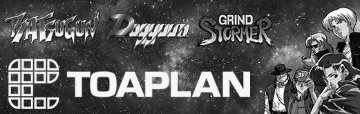

# Toaplan V2 for the Analogue Pocket

**Batsugun, Dogyuun, Grind Stormer and more, now on the Analogue Pocket!**

This core recreates the board these games run on – Toaplan's Version 2
hardware, with its NEC V25 sound processor. It plays five games in total
including Batsugun, one of the pioneering games in the bullet hell genre.

## Supported ROMs

| ROM id | game | notes |
| --- | --- | --- |
| `batsugun` | Batsugun (1993) | Latest version |
| `dogyuun` | Dogyuun (1992) | Latest version |
| `fixeight` | FixEight (1992) | European release |
| `grindstm` | Grind Stormer (1992) | Latest version |
| `kbash` | Knuckle Bash (1993) | Horizontal beat 'em up |

### Other versions

Regional releases and revisions of the games above. On the Analogue
Pocket they're added to the `_alternatives` folder next to the main
games:

| ROM id | game | notes |
| --- | --- | --- |
| `batsuguna` | Batsugun (1993) | An older version |
| `batsugunc` | Batsugun (1993) | Another older version |
| `batsugunb` | Batsugun (1993) | From a Korean board |
| `batsugunsp` | Batsugun – Special Version (1993) | Easier, with autofire |
| `dogyuuna` | Dogyuun (1992) | An older version |
| `dogyuunb` | Dogyuun (1992) | The oldest version |
| `dogyuunt` | Dogyuun (1992) | The 10/9/1992 location test |
| `fixeightk`, `fixeighth`, `fixeighttw`, `fixeighta`, `fixeightu` | FixEight (1992) | The Korean, Hong Kong, Taiwanese, Southeast Asian and US releases |
| `fixeightj` | FixEight – Jigoku no Eiyuu Densetsu (1992) | The Japanese release |
| `fixeightt`, `fixeightkt`, `fixeightht`, `fixeighttwt`, `fixeightat`, `fixeightut`, `fixeightjt` | FixEight (1992) | Under licence to Taito: the European, Korean, Hong Kong, Taiwanese, Southeast Asian, US and Japanese releases |
| `grindstma` | Grind Stormer (1992) | An older version |
| `vfive` | V-Five (1993) | Grind Stormer's Japanese release |
| `kbashk` | Knuckle Bash (1993) | From a Korean board |

FixEight's versions differ only in the factory settings (the region and
licence).

## Installation

No game data comes with this core – you will need to supply your own MAME ROM
sets (`batsugun.zip`, `fixeight.zip` etc). For a clone, like `batsugunsp`, you
also need its parent's zip, unless your set is merged.

### Make the game files

You can't just drag and drop your MAME files. The Analogue Pocket can't read
zips, and the core needs each game as one file with every chip in its correct
place. There's a script in the repository that puts this all together for you,
or you can use a tool like Pocket Updater.

1. Download this repository (**Code → Download ZIP**, then unzip it) or clone it. You'll need Python 3 to run the build script.
2. Put your MAME zips in a folder.
3. In a terminal, from the repository's folder, run the script with the ROM ids you want from the tables above, separated by commas (or `all` for all 28, which needs every zip):
   
   ```sh
   python3 tools/pocket/build_rom.py batsugun,fixeight ~/path/to/roms build/pocket
   ```
   
   So this will write `build/pocket/batsugun.rom` and `build/pocket/fixeight.rom`. The script finds the right chips in whatever zips you have, merged or split, and checks them against MAME's checksums.

[`tools/pocket/README.md`](tools/pocket/README.md) includes more info on this.

### Copy to the Pocket

1. Download the zip from the latest release on GitHub and copy its `Cores`, `Platforms` and `Assets` folders onto your Pocket's SD card.
2. Copy your `.rom` files into `Assets/toaplan2/common/` – for example `Assets/toaplan2/common/batsugun.rom`.
3. On the Pocket: openFPGA → Arcade Multi → Toaplan V2, and pick your rom.

## Controls

| Input | Action |
| --- | --- |
| D-pad | move |
| A | shot (button 1) |
| B | bomb (button 2) |
| X | button 3 (Knuckle Bash) |
| R | rapid shot – the same as quickly tapping the A button |
| L | FixEight's test button, while Test Mode is on |
| Select | insert coin |
| Start | start |

Opening the Analogue Pocket menu will pause the game.

FixEight takes up to three players. On the Analogue Dock, the second and
third players are the Dock's controllers 2 and 3.

The Pocket's own menu has the usual **Display Mode** and **Controls** entries. Under **Core
Settings** there are four options:

- **Test Mode** – the arcade board's own test mode, with its input and sound checks. Turning it on restarts the game in test mode, and turning it off restarts it as normal. Batsugun, Dogyuun, Knuckle Bash and Grind Stormer take their settings (difficulty, lives etc) from switches on the board, which the core keeps at their defaults. FixEight keeps its settings in memory on the board instead: there Test Mode presses the board's test button, and L presses it again to step through the test screens to the menu where you set them. FixEight's settings are saved on the SD card.
- **Reset Game**
- **Screen Rotation** – Upright, Tate (left) or Tate (right). Tate shows the vertical games full size with the Pocket on its side. Knuckle Bash is a horizontal game and isn't turned.
- **Diagnostic overlay** – probably best to ignore this

## Analogizer

The core supports RndMnkIII's [Analogizer](https://github.com/RndMnkIII/Analogizer),
which plugs into the Pocket's cartridge slot. It sends the arcade board's own
picture to a CRT or TV, and lets you play with SNAC controllers.

- **Video** – the board's original 15 kHz signal as RGBS, RGsB, YPbPr or Y/C (NTSC or PAL), or 31 kHz for a VGA monitor through the scandoubler, with 0–75 % scanlines (HQ2x shows as the plain scandoubler).
- **Controllers** – DB15, NES, SNES and PC Engine pads through a SNAC adapter, for either player. FixEight's third player can be on SNAC as well: SNAC 1 with the assignment that sends SNAC to players 3 and 4, or a PC Engine multitap's third pad. The buttons work as they do on the Pocket (on a DB15 stick, A–C are buttons 1–3 and F is rapid shot).
- **Setup** – the core reads the shared `analogizer.bin` in `Assets/analogizer/common/`, which Pupdate or AnalogizerConfigurator writes. That file sets the video mode, the controllers and whether the Pocket's own screen stays on. Without it the core works as normal.

Once an Analogizer is set up in `analogizer.bin`, the core drives the cartridge
slot, as every Analogizer core does, so play with the adapter in the slot
rather than a game cartridge. Without it set up, the slot's pins are left idle,
and a cartridge left in the slot is fine. This is standard Analogizer
functionality.

Please note: The core screen rotation settings can only be used to rotate the Analogue Pocket's own screen. All of these games but Knuckle Bash are vertical games, where the monitor/CRT is designed to be placed on its side, as in the arcade. **If using an Analogizer, you will need to rotate your screen 90° anticlockwise to play these games properly.**

## Technical details

- The core recreates Toaplan's Version 2 board with the V25 in hardware logic, built on [TheJesusFish's Dogyuun MiSTer core](https://github.com/TheJesusFish/Arcade-Dogyuun_MiSTer) with a Pocket shell. One bitstream plays every game; the ROM file decides which.
- It's been checked against MAME in simulation – the main processor's moves matching MAME's but for a few loops that wait on the screen, every write of the sound processor identical, MAME's pictures redrawn pixel for pixel, and the music played from the same sound chip writes in the same order.
- To build it yourself: `tools/bootstrap.sh`, then `sh pocket/build.sh` (Quartus Prime Lite 21.1 in Docker on Colima, with the repository under your home folder; about half an hour). The finished SD card layout can be found in `pocket/dist/`.

## Credits and licence

- **TheJesusFish** – the Dogyuun MiSTer core this is built on, which grew from **Erin Olafsen (va7deo)**'s Toaplan scaffolding.
- **Pramod Somashekar (pram0d)** – the GP9001 video chip.
- **nand2mario** – z8086, the 8086 core the V25 is built on. Its 8086 microcode is a reconstruction of Intel's original, and as z8086's own README notes, its copyright status is uncertain.
- **Jorge Cwik (ijor)** – fx68k, the 68000 processor.
- **Raki (ika-musume)** – IKAOPM, the YM2151.
- **Jose Tejada (jotego)** – jt6295, the OKI sound chip, and the jtframe SDRAM controller.
- **RndMnkIII** – the Analogizer and its adapter module, with **Mike Simone**'s Y/C encoder and **Till Harbaum**'s scandoubler from MiST.
- **agg23** – the Pocket utilities used for loading and audio.
- **Analogue** – the openFPGA core framework.
- **The MAME team** – whose work on the Toaplan boards and the V25 was referenced.
- Pocket port by **Frazilpop**.

GPL-3.0-only. [`THIRD-PARTY.md`](THIRD-PARTY.md) lists every dependency and its
licence.

Batsugun, Dogyuun, Knuckle Bash, FixEight, Grind Stormer and V-Five are ©
Toaplan. This project contains no game data.
